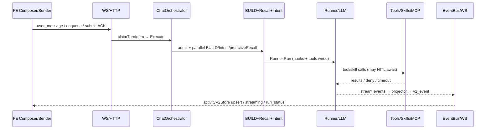

# Chat Turn Full Chain

> Snapshot of `dev` @ `70ebc274b` (+ this doc). Product chat path: Admin `/chat` → WS/HTTP → `ChatOrchestrator` → trpc-agent-go → EventBus → FE `activityV2Store`.

This document is the durable map of one user turn: send → admit → build (tools/skills/MCP) → memory inject → LLM → tool/skill/HITL loop → v2 events → UI. Evidence paths are relative to the repo root.

---

## 1. End-to-end chain

```text
Composer (web)
  → useChatSender.sendUserContent
      · optimistic Task(request_id = pending-user-<uuid>)
      · idle: WS user_message | active run: HTTP /v1/chat/enqueue | WS down: HTTP submit ACK
  → BE: WS handleUserMessage | ChatService.ExecuteTurn | SubmitChatMessage
  → claimTurnIdem (memory + chat_turn_submit_claim)
  → ChatOrchestrator.Execute → runNativeAgentTurnBody
      · team → executeTeamTurnViaHooks
      · agent → runSingleAgentViaTRPC
  → admitTurn → early run_status=running
  → parallel errgroup:
      BUILD (buildTurnRunner / BuildTRPCLLMAgentCached)
      IntentPass (optional, timeout)
      proactiveRecall (4s, optional)
  → WithProactiveHits + WithTurnCuePrefetch
  → Runner.Run → BeforeModel hooks (memory cue L1–L4/case) → LLM
  → tool / skill / MCP loop (+ HITL confirm await)
  → ConsumeEventStream → ActivityProjector → Sequencer → EventBus (type=v2_event)
  → WS → handleV2Event → eventRouter → activityV2Store → TaskList
```



Key entrypoints:

| Stage | File (approx) |
|-------|----------------|
| FE send | `web/.../useChatSender.ts` |
| WS user message | `internal/service` WS handler → `chat_native.go` `ExecuteTurn` |
| HTTP turn API | `chat_orchestrator_turn_api.go` |
| Single-agent turn | `chat_orchestrator_turn_trpc.go` `runSingleAgentViaTRPC` |
| Agent build | `internal/agent/trpc_build.go` `buildTRPCLLMAgentWithToolSets` |
| Callback chain | `internal/agent/callback_chain.go` |
| Stream consume | turn helpers / ActivityProjector / `v2/sequencer` |

Send / idempotency / reconnect (Phase A of PR #106): BE reuses `request_id` as root Task ID; durable `chat_turn_submit_claim`; Team+Agent pass `lastEventId`; outbox still replays **critical terminal** events only — in-flight relies on REST hydrate. See PR #106 and related chat send docs for the patch set.

---

## 2. Memory L2–L4 (+ case) injection

### 2.1 When it runs

Memory is **not** baked into the cached system instruction. It is injected per model call by a **BeforeModel** hook:

- Registration: `callback_chain.go` → `newMemoryInjectBeforeHook` (priority **5**, `LayerDynamic`).
- Implementation: `internal/agent/memory_inject.go` (~L203–268).
- Cue assembly: `buildRuntimeMemoryCue` (~L293–468).
- Placement: cue appended as a **user-role** dynamic message at the **end** of `Messages` via `replaceDynamicCue` + marker `<!-- aranea:memory_inject -->`, so DeepSeek system-prefix cache stays stable.

Context budget collector is mounted at turn start: `chat_orchestrator_turn_trpc.go` ~L78 `WithContextBudget(ctx)`.

### 2.2 Parallel prefetch vs BeforeModel

In `runSingleAgentViaTRPC` (~L167–281):

1. **BUILD**, **IntentPass**, **proactiveRecall** run in an `errgroup` (recall capped at **4s**).
2. After `eg.Wait()`, hits are stored: `WithProactiveHits(ctx, proactiveHits)` (~L281).
3. Optional build-time prefetch: `WithTurnCuePrefetch(ctx, buildResult.prefetch)` (~L282).
4. The MemoryInject hook reads proactive hits / prefetch **at first BeforeModel**, not during BUILD — race is intentional: happens-before from `errgroup.Wait`.

Proactive recall: `chat_orchestrator_turn_part3.go` `runProactiveRecall` (~L166–201). Requires policy `MasterEnabled && RecallL2 && InjectL3` and a `ProactiveRecaller`. Failures are non-fatal.

### 2.3 Cue block order

`MemoryCueResult.JoinCues` order:

1. **ProfileCue** — resident `<memory_summary>` / profile card (`MemorySummaryCue`); cold-start may fall back to pinned prefs.
2. **L1Cue** — session working-memory / summary (`l1_prompt.go` `L1MemoryCue`).
3. **RecallCue** — joined `recallParts`:
   - project-state slice (team runtime, if present)
   - pinned preferences (if not already used in summary)
   - **composite L2+L3** *or* standalone L2 + L3
   - **Agent Case** (`case_prompt.go`, max 3)
   - **L4** graph (`l4_prompt.go`)

Chitchat gate (`intent.SkipForDirectReply`): suppresses profile + recall (keeps L1 only) so stable prefs do not leak on “你好”-class turns (`memory_inject.go` ~L307–312, ~L374+).

### 2.4 Layer details

| Layer | Builder | Trigger policy | Notes |
|-------|---------|----------------|-------|
| L1 | `L1MemoryCue` | `InjectL1` | Rebuilt every tool-loop model call even on cue cache hit |
| L2 | `L2MemoryCue` / composite | `RecallL2` | Episodes; line packer `L2RecallBudgetTokens` |
| L3 | `L3MemoryCueWithIDs` / composite | `InjectL3` | Fused multi-scope; dedup vs L1; optional provenance |
| Composite | `CompositeMemoryCueWithHits` | `RecallL2 && InjectL3` | Merges keyword recall + **proactiveHits**; shared packer uses `L3RecallBudgetTokens` |
| Case | `CaseMemoryCue` | `AgentCaseRecaller` wired | Task experience; best-effort |
| L4 | `L4MemoryCue` | `InjectL4` | Mention-rank candidates (not SQL LIKE on full sentence); confidence ≥ 0.3; optional identity/strategy/neighbors |

### 2.5 Budgets and side effects

- **Unified token budget**: `JoinCuesWithTokenBudget(policy.MemoryPromptTotalBudgetTokens)` — block-level drop (recall → L1) before rune hard-cut; marker `[memory cue truncated by prompt budget]`.
- **Per-block packers**: L2/L3/composite line budgets (token estimate via `llmcontext.EstimateTokensFromChars`).
- **Observability ledger**: `context_budget.go` categories `memory_l1` / `memory_composite` / `memory_l4` (chars once per request); does **not** change injection.
- **Per-turn cache**: invocation state key `aranea.memory_cue.turn_cache` — expensive recall reused across tool-loop BeforeModel re-entries; L1 always refreshed; `fresh` gates notice / `injected_count` / L4 reconsolidation **once per turn**.
- Downstream assembly budget (priority 8) and final compact gate (priority 9) can still truncate the whole request after memory inject (`callback_chain.go` comments ~L77–80).

### 2.6 Memory risks / residuals

1. Composite path packer shares **L3** budget token field for fused L2+L3 lines — L2 gist capping mitigates but L2/L3 still compete inside one block.
2. Proactive + BeforeModel both recall-ish work; proactive is best-effort merge, not a substitute for composite.
3. Prefetch vs live `buildRuntimeMemoryCue` must stay keyword-aligned or cache/prefetch short-circuits differently.
4. `ContextBudget` ledger is observability-only; hard limits are policy token budgets + assembly/compact hooks.
5. Skill evolution / sleep-time distill maintain profile cards **off** the hot turn path; inject only reads the card.

---

## 3. Tools / Skills / MCP assembly + HITL

### 3.1 Build assembly (`trpc_build.go`)

`buildTRPCLLMAgentWithToolSets` (~L72+):

1. Resolve model → system prompt (`BuildSystemPrompt` + static capability cue + optional Agents.md).
2. **Skills** (if `SkillUC`): `buildSkillDeps` (~L448–517) → `WithSkills` / `WithSkillFilter` / `WithCodeExecutor` / progressive flags (`WithSkillsLoadedContentInToolResults(true)`, `WithSkillRunRequireSkillLoaded(true)`).
3. **Tools**: load effective keys + `toolBuildCatalog` once; `buildToolConfirmGate`; `buildToolsetsForAgent` → `WithToolSets` + `WithTools`.
4. MCP ToolSets: assembled inside tool build (`internal/tools/toolset_assemble.go`, `buildMCPToolSet`); schema governance `GovernMCPServerToolSets`; cache invalidators → `WithRefreshToolSetsOnRun` when needed.
5. Fingerprint includes `ToolVersionHash` / `SkillVersionHash` / **`MCPVersionHash`** for cache + hot-swap (`hot_swap.go`).

Local tools go to `ts.Tools`; MCP (and some factories) go to `ts.ToolSets`. Deferred tools may sit in a catalog cue until promoted.

### 3.2 Skills (Layer A vs B)

- **Layer A (overview)**: visibility filter from `skill_runtime_json` — stable prefix for prompt cache (`buildSkillDeps` comments ~L497–500).
- **Layer B (guidance)**: dynamic BeforeModel cues in `skill_guidance_inject.go` / `newSkillGuidanceBeforeHook` — does not hide skills from overview.
- Workspace skills: `wrapWorkspaceSkillsRepo`.
- **Skill evolution** (`ChatEvolutionDeps` / distill triggers) is **not** on the per-turn prompt assembly path; it feeds future skill corpus / butler tools.

### 3.3 Callback chain (model + tool)

Order relevant to this map (`callback_chain.go`):

- Static/dynamic runtime cues, tool catalog cue, context compression prep  
- Skill guidance / workspace skills  
- **Memory inject (prio 5)**  
- Failed-tool dedup → **assembly budget (8)** → working-memory / compact (9)  
- Tool confirmation is a **BeforeTool** hook (prio 10), not BeforeModel  

### 3.4 HITL tool confirmation

| Piece | Role |
|-------|------|
| `tool_confirm_gate.go` | Decision: danger floor → param-rule verdict → catalog/plugin → grants → prompt |
| `tool_confirmation.go` | BeforeTool: emit confirm activity, `AwaitHook` wait (default **5 min**, retry once), approve/deny/timeout |
| `chat_orch_await.go` | `MakeAwaitReplyFunc` sets `ChatAwaitKindToolConfirm` when tool-confirm request in ctx |
| Grants | Session store (process TTL) + persisted `ToolUC.HasToolGrant`; danger floor **never** bypassed by grant |

Shell special cases: safe read-only may skip first card; after failure, safe shell can re-require confirm (`confirmReasonShellOnFailure`).

Computer-use: danger words / injection-suspected force confirm every time.

### 3.5 Tools / Skills / MCP risks / residuals

1. Cold build still expensive on cache miss (catalog batching reduced N× GetTool; MCP connect cost remains).
2. MCP schema governance may truncate/degrade large catalogs — model sees governed view, not raw server list.
3. HITL wait is blocking inside the tool callback; FE must keep session/WS alive; silent-wait visibility only after ~60s (`hitlWaitVisibleAfter`).
4. Plugin confirmation guard must see `WithToolConfirmHandled` after product allow — ordering bugs historically caused double-block or silent allow.
5. Progressive skill load keeps bodies out of system[0]; operators debugging “skill not in system prompt” should look at tool results / overview, not instruction.

---

## 4. LLM loop → frontend

1. `Runner.Run` with assembled agent + `AwaitHook` on deps (`turn_trpc.go` ~L368).
2. Framework multi-step: model → (optional tools) → model…; each model call re-enters BeforeModel (memory cache hit after first fresh build).
3. Stream: `ConsumeEventStream*` → projector → sequencer assigns Seq, writes outbox, publishes `v2_event`.
4. FE: `useChatStreamManager` / `handleV2Event` → cursor + stall/first-byte hooks → `eventRouter` → `activityV2Store`.
5. Terminal `run_status` clears sending / enables follow-up queue.

---

## 5. Known residuals (accepted)

| Area | Residual |
|------|----------|
| Idempotency | Successful claims intentionally retained (permanent dedupe); failure `Release` |
| Task IDs | `pending-user-*` may persist as root Task ID after adopt |
| Outbox | Critical terminal replay only; in-flight → REST hydrate |
| Memory | Composite L2+L3 share one block budget; chitchat suppresses recall |
| HITL | Long waits need FE/session discipline; grant + danger semantics are easy to misread in audits |
| Dual channel | WS is the render source of truth; HTTP ACK must not drive a second timeline |

---

## 6. Related code index

```text
internal/service/chat_orchestrator_turn_trpc.go   # turn orchestration
internal/service/chat_orchestrator_turn_part3.go  # proactiveRecall
internal/service/chat_orch_await.go               # HITL await kinds
internal/agent/trpc_build.go                      # tools/skills/MCP wire-up
internal/agent/callback_chain.go                  # BeforeModel / BeforeTool chain
internal/agent/memory_inject.go                   # L1–L4/case cue + budget join
internal/agent/l2_prompt.go / l3_prompt.go / l4_prompt.go / case_prompt.go
internal/agent/composite_prompt.go                # fused + proactive merge
internal/agent/context_budget.go                  # observability ledger
internal/agent/tool_confirm_gate.go               # confirm decision
internal/agent/tool_confirmation.go               # confirm await UX
internal/tools/toolset_assemble.go                # MCP ToolSet assembly
```

