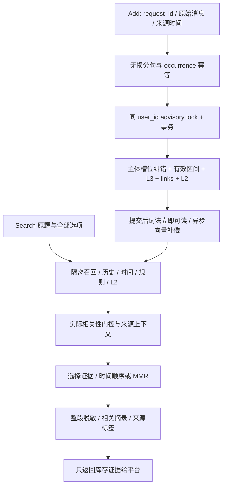

# Agent Memory Challenge 文本评分短板分析与代码优化

日期：2026-10-22。分析源：用户提供的三张评分截图、当前工作区源码、[官方评测契约](https://agentmemoryleaderboard.ai/evaluation)和[赛事规则](https://agentmemoryleaderboard.ai/competition/)。截图分数是既有观测，不是本轮代码的复测结果。

最新进展：第三轮已按用户确认的 r2 Full 基线完成生命周期、结构、关联、背景、指令范围、时间区间与综合证据覆盖优化。累计 120 项目标回归、9 项 race 和 96 条实际 HTTP 断言通过；这些本地结果不代表新的正式评测成绩。第三轮详见 §8 及本地验收报告，前文保留前两轮记录。

## 1. 结论与交付范围

实际参评入口是 `cmd/memoryeval`，调用 `biz.EvalMemoryStore` 与 `data.evalMemoryStore`，复用 L3 事实、L2 会话转录和可选向量索引。它没有经过 Chat 的 Agent 组装和最终回答生成；因此本轮优化集中于 Add/Search 证据链。

完成三组修复：证据不丢失、记忆状态不误覆盖、检索上下文能覆盖时间/规则/长历史。外部 JSON 契约兼容，未增加 LLM、Schema、迁移或正式评测调用。当前工作区其他改动保留，未创建版本 tag 或提交参评版本。

本地验证包含 76 个顶层目标测试、4 个 race 测试，以及 Linux 程序连接全新 Postgres 后的真实 HTTP 冒烟。详细记录见[本地验收报告](../testing/reports/acceptance-2026-10-22-amc-score-optimization.md)。这些证据说明实现符合所测行为，不能推出正式分数提升幅度。

## 2. 评分项与源码缺口

| 截图项 | 既有分数 | 代码中发现的缺口 | 本轮措施 |
|---|---:|---|---|
| A1 单点事实/属性与来源 | 66.67 | 连续英文分句额外推进字节游标；短于 4 字符的片段被丢弃；同文指纹覆盖来源 | 修正游标、保留短标签，按来源 occurrence 建稳定指纹，补全来源时间/序号 |
| C1 日期、相对时间、间隔 | 46.67 | Search 使用墙钟；月被当成首日；缺绝对日期统一解析；只看首个日期 | 按同用户最新已知来源时间锚定；日历校验与周/月区间；多日期相交；补中英数量单位 |
| C2 顺序/误排序 | 40.00 | 先按日期排序再截 top_k；同日以分数破平；RFC3339 小数秒不能直接按字符串排序 | 先选相关证据，再按事件日期、真实时间值、消息/原子序号排序 |
| D1 新值/当前状态 | 66.67 | 重放缺时间戳时可能再覆盖；并发或迟到旧消息留下多个当前值 | 来源消息幂等、同用户事务锁、晚到旧值登记已结束的有效区间 |
| D2 矛盾与冲突 | 40.00 | 身份槽混同姓名/工号；不同主体互相覆盖；相似度达到阈值即可失效 | 主体/说话人/属性联合约束；显式偏好否定/反向纠正；相似度只作候选发现 |
| F1 长历史综合 | 0.00 | 聚合仅补最近 5 条 L2；长转录头部占据上下文，相关尾部被挤出 | 全用户历史内按主题取候选，聚合候选上限 64，保留早期相关会话；相关窗口摘录 |
| G2 规则应用 | 20.00 | 收到 `options` 却不使用；通用题干无法召回具体选项线索 | 原问题独立召回 + 所有选项平等参与的第二路召回，输出只取库存原文 |
| G4 经验数据归纳 | 0.00 | A=1、短示例丢失，规则和例外分离后缺上下文 | 保留短样例；system/developer 原文作为指令证据；通过门控后批量取同消息上下文 |
| H2 最小披露 | 50.00 | 只掩 CN 电话/身份证/银行卡；邮箱与住址透出；先裁剪可能丢失凭据标签 | 补国际电话、邮箱、街道住址、SSN 与凭据；先整段脱敏再摘录；类别匹配使用英文词边界 |
| I1 在线学习 | 45.24 | 请求重放、乱序与部分写入影响状态；索引补齐前证据一致性不足 | Add 事务提交后可立即词法检索；来源幂等、回滚与迟到事件处理；保持已有异步索引补偿 |
| I2 内部迁移 | 50.00 | 新问题只按题干找记录，旧例子/规则的关键线索没进入召回 | 选项联合召回、规则候选、同消息证据扩展与有界上下文 |

B、E 及截图中的满分子项保留相关读取路径，但本地用例不能证明新版本正式评测仍保持满分。F1/G4 的最终综合与归纳由平台 Answer 执行，本轮不在 Search 代答。

## 3. 实现链路

### 3.1 Add：幂等与事务

HTTP 无 `message_id` 时以 `request_id + 消息位置` 补稳定标识。指纹包含用户、会话、来源消息、来源时间、原子位置与原文。新时间或新会话的同文保留各自来源；已存在的 occurrence 在纠错前跳过。

同一用户的写请求通过 PostgreSQL 事务级锁串行化，事实、旧值失效、同消息 links 和 L2 同事务。任何一步失败整批回滚，提交后才安排索引。L2 仅投影本批写入后仍活跃的原子，避免同批纠正又把旧句追加回转录。L2 task key 包含用户，避免相同 session_id 的不同用户碰撞。

失效边界使用更正的来源时间；迟到旧消息作为历史区间保留，不成为当前值。无法确定主体/属性的更新保持保守，向量相近不等于矛盾。未来计划或假设不覆盖当前事实。喜欢另一件事不意味着放弃所有旧偏好；明确否定同一对象才覆盖相应偏好。

### 3.2 Search：相关性与完整性

最多两路主要召回：原问题，以及问题与全部选项的组合。选项最多 16 个、单项最多 1024 rune、总线索最多 8192 rune。模式、时间和隐私策略只分析原问题，选项不进入库存或输出。

候选量按 top_k 扩至 64–800；历史/规则候选在当前 user_id 内取，扫描投影不读取 embedding_blob。相关性使用词法重合或真实向量分数；重要度、新鲜度和质量只能破平，不能单独构成证据。泛化个人概况与纯日期查询有独立判定，避免严格门控造成空召回。

聚合候选覆盖同用户的早期相关会话，不再固定只看最后五条。通过门控的来源种子可批量扩展最多 64 个链接原子；新 links 只连接同一条源消息。每条证据摘录约 1800 rune，正文总预算约 36000 rune，保留原文顺序和省略标记；来源标签另计。证据没有被改写成最终答案。

### 3.3 时间语义

无 query 时间字段时，最新已知来源 timestamp 是可复现锚点；没有来源时间的相对表达保留原文，不以执行日制造事件日期。日历范围区分日、周、月，拒绝 2 月 30 日等无效日期。每个原子可有多个事件区间，范围按区间相交判断；历史属性可使用事实有效区间。

历史检索保留 `superseded` 和 `valid_until`，普通当前状态检索排除失效项。时间问题附带时间戳与来源序号，月级证据前缀显示范围。当天多次变化不会被伪装成唯一日期点。

## 4. 关键代码锚点

| 代码 | 职责 |
|---|---|
| `cmd/memoryeval/handler.go` | 选项转发与稳定来源消息标识，外部 JSON 契约 |
| `internal/biz/memory_eval_classify.go`、`memory_eval_subject.go` | 无损分句、主体/槽位、明确矛盾与未来计划守卫 |
| `internal/biz/memory_eval_time.go`、`memory_eval_dates.go`、`memory_eval_query.go` | 日历精度、相对单位和查询模式 |
| `internal/biz/memory_eval_retrieval.go` | 原题/全选项两路检索线索与上限 |
| `internal/data/memory_eval_ingest.go` | 用户级事务、幂等、精简治理读取、来源元数据 |
| `internal/data/memory_eval_store.go`、`memory_eval_search.go` | 历史区间、召回融合、门控、来源扩展与摘录 |
| `internal/data/memory_eval_store_part2.go` | 时间规范化、前缀与最小披露 |
| `internal/biz/memory_eval_regression_test.go`、`internal/data/memory_eval_regression_test.go`、`cmd/memoryeval/handler_test.go` | 20 个新增顶层回归测试及既有行为回归 |
| `test/agent-memory-challenge/` | 可复用测试脚本、JSONL 结果与真实接口冒烟 |

## 5. 部署与验证边界

1. 本地 Windows 与 Linux/amd64 构建启用 `pgvector`；Linux 产物已连接全新 PG 数据库执行真实 HTTP 冒烟。真实 embedding 服务、线上语义召回、容量和 P95 延迟未在本轮验证。
2. 手动启动还需项目全局 `KRATOS_AUTH_SECRET`；现有 `docker-compose.eval.yml` 已提供该项。学术榜实际模型配置应继续遵循官方模型要求，本轮没有新增 LLM。
3. 同用户写入锁及选项额外召回带来开销，候选、链接和输出有界；尚无 Full 规模压力测试。启发式主体/属性/隐私识别仍有覆盖边界。
4. 无 DDL 变更；新写指纹发生升级，旧库存可读，未对既有正式评测库回填。新参评版本应使用新的 run/user_id 命名空间并固定代码、配置与产物。
5. 本轮未更新报名版本、未部署公网接口、未提交 Smoke/Full。私有任务状态读取未成功，不据旧记录断言当前名次、成绩或剩余额度。
6. `.gitignore` 忽略 `/docs/` 与 `/test/agent-memory-challenge/*`，分析、三件套、验收记录和脚本为本地交付文件；普通 `git diff` 不展示这些文件。代码和 Go 测试的修改可正常审阅，提交材料时须按项目归档约定一并携带文档。

## 6. 第二轮业务逻辑审查与实施方案

用户补充的总分为 62.12，子项与先前截图一致；未提供对应部署版本或逐题错误，因此不将分数归因于本地第一轮实现。以下是继续追踪现有源码发现的 12 类改进点；实施与验收状态在场景开发计划中维护。

评分统计：20 个子能力中，9 项满分、11 项未满分；9 项不高于 50 分，其中 F1、G4 为 0。优先级按短板与代码证据划分：P0 为 F1/G4/G2/C2/D2，P1 为 C1/I1/I2/H2，P2 为 A1/D1。总分有平台权重，不能用子项简单平均预测提升幅度。

| 编号 | 可复现的业务缺口 | 关联子项 | 方案与验收重点 |
|---|---|---|---|
| Q1 | 只比较当前事实；迟到的中间状态未缩短更早历史状态的有效区间 | D1/D2/C1/I1 | 修补同主体同属性的完整有效区间链；验证 1 月→3 月→迟到 2 月 |
| Q2 | 治理只取最近 2048 条，早期仍有效的属性可能被后续无关属性挤出 | D1/I1 | 来源元数据保存治理键，按键优先取候选，保留旧记录兼容路径 |
| Q3 | 回忆“以前住在…”可能被当成当前状态更新 | D1/D2 | 区分明确过去状态与当前断言，过去记录仅在历史模式进入证据 |
| Q4 | 本周/本月、独立年份及省略年份日期覆盖不全 | C1/C2 | 共享日历解析补齐常见粒度；明确缺少来源锚点时不推断年份 |
| Q5 | 日期标题被单独原子化后，后面的日记行失去该日期 | C1/C2/A1 | 仅从明确日期标题继承事件区间，普通叙述中的日期不扩散 |
| Q6 | 时间过滤在候选截断之后执行，区间内证据可能根本没进候选池 | C1/F1 | 用户隔离的日期条件下推候选查询，时间问题避免按会话创建日筛转录 |
| Q7 | 短规则/示例会在 top_k 或门槛处分离；单字母函数名在普通分词中丢失 | G2/G4/I2 | 按源消息组装原文证据卡，补函数标识检索锚点；不生成规则答案 |
| Q8 | 宽泛总结按早期与高分项截断；L2 与 L3 重复占预算 | F1/G4 | 候选与输出按来源分层覆盖，去除完全被原子覆盖的重复转录 |
| Q9 | 摘录优先首个命中词，通用词抢占尾部关键线索；大小写转换的字节位置可能漂移 | A1/F1/G2 | 使用有效词和窗口覆盖评分，按 rune 安全裁剪，多窗口有界保留 |
| Q10 | 询问居住城市时可放出完整街道；`password is ...` 未被凭据规则识别 | H2 | 细地址仅在明确询问地址时披露，补充英文/中文赋值句式凭据脱敏 |
| Q11 | 邮箱、时区、语言等常见单值属性缺少独立槽位 | A1/D1/I1 | 增加有主体限定的单值槽位，避免不同属性或多人数据互相覆盖 |
| Q12 | 无来源时间回退创建日；统一 UTC 丢失原始日历偏移，午夜相对日期可错一天 | C1/A1 | 区分来源、摄取和本地日历时间；没有来源锚点时保留未知日期 |

本轮继续限定 Add/Search 适配层与其领域辅助函数。所有新增回归使用自造数据，不引入评测题答案、额外 LLM、Schema 迁移或正式评测调用。

## 7. 第二轮实现与证据

### 7.1 已实现改动

| 编号 | 实现 | 主要验收用例 |
|---|---|---|
| Q1 | 同槽位同时读取历史与当前行；新状态按来源时间缩短前驱区间，取最近后继作为结束边界；保留整批事务与用户级锁 | `LateIntermediateStateRepairsHistory`：1 月红→3 月蓝→迟到 2 月绿；2 月中旬只取绿 |
| Q2 | `metadata.governance_key` 由说话人、主体、属性构成；治理读取优先匹配键，兼容无键旧记录 | `GovernanceFindsEarlyAttribute`：2100 条无关属性不挤掉早期颜色属性 |
| Q3 | 明确“以前/used to/previously”等过去状态作为历史上下文保存；不覆盖当前，不投影进当前 L2 转录 | `PastResidenceCannotReplacePresent`：过去北京/柏林与当前杭州/罗马分开检索 |
| Q4 | 补本周、本月、年份及中英省略年份日期；无效完整日期不退化成年/月；纯日历问句与新粒度同步 | `CurrentPeriodsAndYearlessDates`、`CalendarOnlyPeriodQueries`、`InvalidDateDoesNotBecomeCoarserPeriod` |
| Q5 | 仅孤立日期标题的区间可以继承到后续无日期原子；重放标题后追加新原子仍继承日期 | `DateHeadingDatesFollowingAtoms`、`ExtendedDiaryRetainsReplayedHeading` |
| Q6 | 日期范围匹配下推到候选 SQL 的 LIMIT 前，包含多事件区间和属性有效期；不再将 L2 创建日当作逐行事件日 | `DateFilteringPrecedesCandidateCap`：目标位于 300 条前后噪声的中间仍能以 top_k=1 取回 |
| Q7 | 同会话、同源消息、同来源时间的原子按原顺序组成证据卡；补函数调用锚点和规则模式；只拼接库存文本 | `RuleMessageSurvivesSmallTopK`、`FunctionTransferRetrievesStoredDemonstrations`；复用 ID 的不同来源时间保持分开 |
| Q8 | 聚合 SQL 按来源会话分层取候选；输出优先覆盖不同来源，宽泛总结对过多来源均匀取样；完全被 L3 覆盖的 L2 转录去重 | `GlobalSummaryCoversSessions`：候选 cap=3 与输出 top_k=3 都覆盖 3 个来源 |
| Q9 | 按有效词稀有度和窗口覆盖挑选原文片段；最多保留两个不相交窗口；rune 位置规避 Unicode 大小写字节漂移；正文总预算按剩余单元分配 | `PrefersSpecificTail`、既有 `RetainsRelevantTail`；长规则卡上限 6000 rune，普通条目上限 1800，正文总预算 36000 |
| Q10 | 问城市/居住不自动放行完整街道；支持 `password is`、`密码是/为`、引号赋值及 E.164 电话；先脱敏再摘录 | `CityAndCredentialAssignments` 与 Linux 实际隐私断言；明确 street address 请求仍可取地址 |
| Q11 | 邮箱、时区、首选语言各有独立槽位和主体约束 | `IndependentSingleValueAttributes`、`SingleValueAttributesUpdateIndependently` |
| Q12 | 新来源同时保留规范化时间与原始偏移的日历锚点；无来源时间不伪造事件日；空用户/未知锚点正常返回空或无时间限制检索 | `UnknownSourceDoesNotBecomeIngestionDay`、`LocalCalendarAnchorAcrossMidnight`；UTC+8 午夜的“昨天”保持本地日历日 |

### 7.2 代码与验证锚点

- 领域：`internal/biz/memory_eval_subject.go`、`memory_eval_classify.go`、`memory_eval_calendar.go`、`memory_eval_dates.go`、`memory_eval_query.go`、`memory_eval_retrieval.go`。
- 写入与时间：`internal/data/memory_eval_ingest.go`、`memory_eval_store.go`、`memory_eval_candidates.go`。
- 证据组织：`internal/data/memory_eval_evidence.go`、`memory_eval_excerpt.go`、`memory_eval_search.go`、`memory_eval_store_part2.go`。
- 新增用例：`internal/biz/memory_eval_quality_test.go`（5 个）、`internal/data/memory_eval_quality_test.go`（16 个）。既有地址查询用例改为明确询问街道地址；聚合用例改验来源完整性及无重复转录，保留原有直接 L2 去重测试。
- 实际请求：`test/agent-memory-challenge/live-quality-smoke.ps1`；兼容请求使用 `live-score-smoke.ps1 -ResultsFile quality-compatibility-smoke-results.json`。
- 构建碰到另一个工作区新增文件 `internal/data/approval_policy_repo.go` 使用数据库端口未提供的 `QueryRowContext`。经用户明确授权，仅将这一处读取改为 `QueryContext` + 单行扫描，保留原有错误映射；之后 Windows/Linux 构建恢复。审阅补丁保存在 `test/agent-memory-challenge/approval-policy-compile-fix.patch`。

完整计数、构建哈希及运行条件见[验收记录第二轮](../testing/reports/acceptance-2026-10-22-amc-score-optimization.md#第二轮业务逻辑优化验收)。

### 7.3 实际边界与正式复测条件

12 类改进已实现，不能据此声称 11 个低分子项都已解决或预估涨分。F1/G4 的本轮改进是来源覆盖、示例完整性与有界原文组织，最终综合和归纳仍由平台 Answer 完成。函数锚点是确定性检索线索，不是通用程序推导器。

主体/过去状态/属性/隐私仍是启发式识别；无键旧库存的兼容治理仍有候选上限，未自动回填或重建线上历史。Unix 时间按 UTC 解释，只有原始 RFC3339 提供偏移时才保留本地日历锚点。过长来源仍可能摘录，截断会显示省略标记。

本地覆盖了真实 PostgreSQL 和 HTTP；真实 embedding、Full 容量、线上 P95 与正式分数没有新增验证。下一次正式复测需固定源码、配置、产物哈希及新 run/user_id 命名空间，确认实际部署版本包含本轮改动。当前共享工作区与产物用于本地验收，尚未作为冻结参评版本提交。

## 8. r2 Full 基线与第三轮方案

用户确认来源：`teval_e176051a414de4db`，文本赛道，版本 `amc-2026.09-r2`，运行 `r2-full-1`，Full，Add 并发 16、Search 并发 32、top_k=100。这是前两轮本地优化之前的参评版本，不能将其与前面的 Smoke 分数直接当作优化前后对比。

Full 共 27 个子能力，17 项低于 50，8 项低于 35。低于 35 的项目是 F1 14.24、G4 16.98、D3 20.00、E3 26.90、B3 29.71、G3 30.00、A3 33.39、I1 34.52。I2 为 99.26，D4 为 81.63；新增能力应保留这两项的适用范围与迁移边界。

| 类别 | 分数 | 子项 |
|---|---:|---|
| A | 50.51 | A1 55.24 / A2 58.42 / A3 33.39 |
| B | 41.23 | B1 40.81 / B2 49.39 / B3 29.71 / B4 52.54 |
| C | 43.49 | C1 43.77 / C2 42.85 / C3 37.19 |
| D（含 F1） | 56.99 | D1 49.78 / D2 65.03 / D3 20.00 / D4 81.63 / F1 14.24 |
| E | 38.14 | E1 46.20 / E2 60.87 / E3 26.90 |
| G | 45.95 | G1 55.48 / G2 55.76 / G3 30.00 / G4 16.98 / G5 46.70 |
| H | 60.92 | H1 67.71 / H2 40.80 |
| I | 42.61 | I1 34.52 / I2 99.26 |

第三轮业务方案：

| 编号 | 已定位缺口与改进 | 主要能力 | 验收重点 |
|---|---|---|---|
| R1 | Add 缺删除/停止记忆/恢复记忆语义；新增用户范围内逻辑删除、转录重建、重放保护和持续抑制控制记录 | D3/H2/I1 | 只处理明确用户指令；引文和第三方消息不执行；L3/L2/历史均不泄漏；恢复后只接收新事实 |
| R2 | JSON、表格、列表及标题可能在原子化后失去字段归属；保留结构化原文单元，识别集合枚举查询 | A3/A1/F1 | 嵌套 JSON 可解析，表格标题及列表完整；来源不混合，不生成抽取答案 |
| R3 | 跨消息中间事实缺题干词被门控移除；从已通过门控的种子展开有界实体证据 | B1/B2/B3/A2 | 两跳支持链、方向原文、已失效/删除行过滤、用户与范围隔离、无种子不展开 |
| R4 | 饮食/关怀等问题难以召回用不同词描述的个人背景；增加有明确触发条件的背景检索线索 | E1/E3/F1 | 食物请求可取过敏/饮食约束；非相关问题不注入健康背景，不把他人属性当用户事实 |
| R5 | 工作流、格式指令和有范围的规则缺稳定归类与适用性约束；补范围键与步骤/格式模式 | G3/G5/D4 | 项目 A 指令不覆盖项目 B；有序原文步骤保留；新旧格式状态可追溯 |
| R6 | 历史属性按日字符串比较可能与来源偏移不一致；按查询日历的实际时间区间匹配有效期，补轨迹查询 | C1/C2/C3/D1 | 跨午夜属性区间、同日多状态、轨迹包含历史证据 |
| R7 | 总结的来源覆盖尚不能保证结构/背景/规则等不同证据类型；加入类型覆盖与明确省略 | F1/G4/H1 | 有界预算内覆盖相关类型；空证据保持空；不编造总结或规则输出 |

控制记录仅存选择器摘要、类别、模式和来源元数据，不作为检索证据或 L2 原文。逻辑删除不等同于底层物理擦除。本轮仍不改外部 Add/Search JSON，不新增 LLM、数据库表或迁移，不部署或提交新的正式评测。

## 9. 第三轮实施结果与剩余边界

### 9.1 代码业务链与实现

入口仍为 `cmd/memoryeval/handler.go` → `biz.EvalMemoryStore` → `data.evalMemoryStore`。Add 的事实、生命周期控制、历史失效与 L2 投影共用一次事务及用户锁；Search 继续返回库存证据，由平台 Answer 完成答案。不是通过生成答案替代记忆检索。

| 包 | 已实现内容 | 关键代码 | 针对性证据 |
|---|---|---|---|
| R1 | 明确单条用户指令触发按属性/主体或字面目标遗忘；持续抑制和明确恢复分别记录；删除覆盖历史与当前，重建 L2；已删 occurrence 的重放不能复活 | `biz/memory_eval_control.go`、`data/memory_eval_control.go`、`memory_eval_ingest.go` | 7 项生命周期回归先通过；随后补引文混入、批次回滚及 Add16/Search32 并发验收 |
| R2 | 合法复合 JSON、代码围栏、Markdown 表格、编号/项目列表、TSV 保留原始单元；枚举问题启用集合覆盖，结构化内容不参与单值属性覆盖 | `biz/memory_eval_context.go`、`memory_eval_classify.go`、`data/memory_eval_evidence.go` | JSON 在 top_k=1 下仍可解析；表格、列表、流程头与顺序原文通过领域及真实 HTTP 断言 |
| R3 | 从通过门控的 L3 种子取字面实体，最多两跳，每跳最多 64 行；只取同用户有效且未删除的库存行，附 `linked_source`；输出不保留缺父证据的分支 | `data/memory_eval_relations.go`、`memory_eval_search.go` | 三个 session 的中间消息可在 top_k=3 返回；删除桥接后链不回流；无种子保持空，孤立支持行被拒绝 |
| R4 | 饮食/情绪关怀请求补入明确背景检索词，仅提升用户本人的相关背景，不把朋友或家属健康归给用户 | `biz/memory_eval_context.go`、`memory_eval_subject.go`、`data/memory_eval_search.go` | snack 请求召回用户花生过敏，不携带朋友草莓过敏；无关设备问题不追加健康背景 |
| R5 | 显式项目/工作区范围进入指令治理键；格式与篇幅各有槽位；读取 L3 与 L2 都校验范围；步骤模式保留工作流原文 | `biz/memory_eval_context.go`、`memory_eval_subject.go`、`memory_eval_query.go`、`data/memory_eval_applicability.go` | Aster JSON→YAML 不改变 Birch XML；引文与 assistant 文本不成为用户格式策略；工作流步骤按原顺序返回 |
| R6 | 历史属性按来源时刻的 `[from,until)` 与查询本地日历 `[日初,次日日初)` 相交；SQL 候选与最终过滤使用相同规则；轨迹问题保留历史并排序 | `data/memory_eval_validity.go`、`memory_eval_candidates.go`、`memory_eval_store.go` | UTC+8 的 00:00/00:30 更新不串到前一日；午夜结束的旧值不进入次日，同日三次变更按来源时间返回 |
| R7 | 宽泛总结使用固定正门槛保留真实相关来源，在来源覆盖后优先补结构、个人背景、指令等尚未覆盖类型；总预算继续有界 | `data/memory_eval_applicability.go`、`memory_eval_evidence.go` | 密集偏好记录不能占满三条预算而挤掉相关背景与指令；空证据、不同用户和无依据关联负例通过 |

本轮先在旧实现上复现 8 个新增业务失败，另复现两个本地午夜状态用例失败，再修改业务逻辑。删除属性选择器限制为属性名词短语；“昨天那通电话”等字面目标不会扩大为整个电话属性删除。多行文档/引文和多句混合消息不执行控制，明确控制应作为独立消息提交。

### 9.2 验收统计与可审阅产物

- 23 个新增顶层回归：领域 5 个、存储/证据 18 个。目标套件累计 **120 个全部通过**：HTTP 契约 21、领域 26、存储 73，无跳过；子用例与重复执行不另加计。
- **9 项 race 检查通过**，含 16 个并发 Add（包含迟到删除）后 32 个并发 Search 的当前状态一致性，以及重放、乱序和批次回滚。这是本地一致性检查，不能代替 Full 容量或延迟测试。
- 新 Linux 程序连接全新 `aranea_fullfocus_smoke`，通过 **96 条真实 HTTP 断言**：本轮 50、上一轮兼容 25、首轮兼容 21。数据、Secret、Token 全为专用合成值，服务仅绑定回环地址。
- Windows/Linux 均完成 `pgvector` 构建；源码校验清单为 `test/agent-memory-challenge/fullfocus-source-hashes.json`。构建元信息为 Go 1.26.3、Git `34e38f9640009bc927f3d5358f24d8121a73a37a`，工作区含未提交变更；产物应以 SHA256 和源码清单识别，不能把该 HEAD 单独视为冻结版本。
- 复现入口新增 `live-fullfocus-smoke.ps1`；原回归脚本已纳入新领域用例，旧 HTTP 脚本支持独立结果文件。方案、三件套和验收记录已同步。
- 本轮构建曾遇到共享工作区 `board_run_lease_repo.go` 的查询端口编译错误，随后该文件自身更新消除了阻塞；本轮未修改该文件。先前获用户授权的审批策略最小兼容修复仍按第二轮记录归档。

产物、哈希及逐项证据见[第三轮验收](../testing/reports/acceptance-2026-10-22-amc-score-optimization.md#第三轮-r2-full-短板优化验收)。专用两容器与网络已核对 ID 后清理，运行日志保留在 `bin/logs/amc-fullfocus-runtime-20261022.log`。

### 9.3 不能由本地结果推断的内容

1. **尚无新正式得分**。用户确认的 r2 Full 仍是历史基线，不能将本地测试通过当作 F1/G4/D3 等能力已满分，也不能与旧 Smoke 做直接涨跌比较。正式复测前应固定新版本、配置、产物和新的 run/user_id 命名空间。
2. 本轮实际服务未接真实 embedding，未验证线上语义召回、Full 数据规模、P95 或学术模型配置。新增关联、背景候选、策略读取与每用户写锁存在开销；并发一致性通过不代表性能达标。
3. 实体、主体、背景、属性及指令范围均为有界启发式；中文/多语言、代词、复杂否定和隐含范围仍有覆盖边界。共享实体只提供候选支持行及其原文，不证明关系成立或自动推导因果。超出两跳、候选上限或输出预算的链可能缺失；容不下完整链时省略该分支。
4. 控制只接受明确单消息用户命令；不会执行粘贴文档中的命令。逻辑删除及检索抑制不会物理擦除数据库页、备份、旧索引或日志；未知来源时间不推造历史截止点。旧正式库存未自动回填或重建。
5. F1/G4/G3/G5 的改进是原始结构、来源、规则及示例更完整，最终综合、归纳、流程执行与输出格式仍依赖平台 Answer。过长来源会明确摘录，无法保证任意大小 JSON 截取后仍可解析。
6. `/docs/` 和本地比赛脚本目录仍受现有 `.gitignore` 忽略；本次没有改忽略规则或强行暂存。提交参评版本时需按仓库归档约定携带方案与复验证据。
